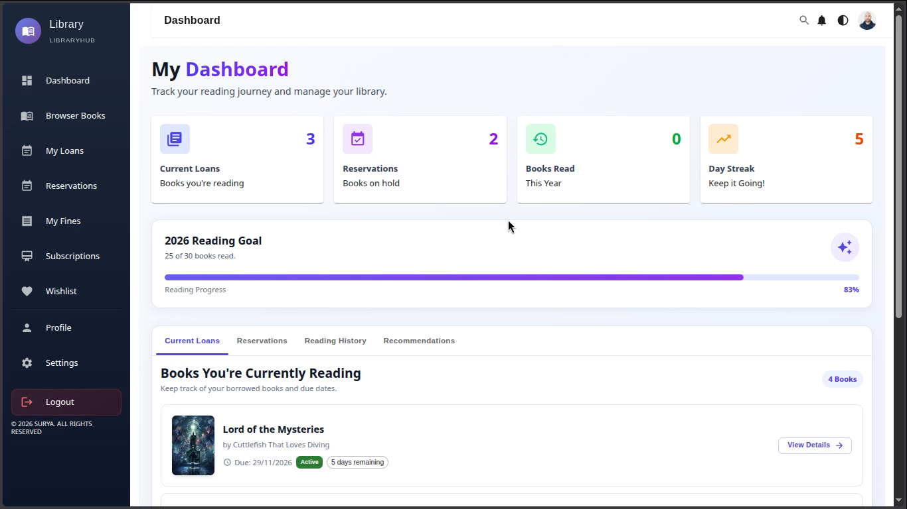
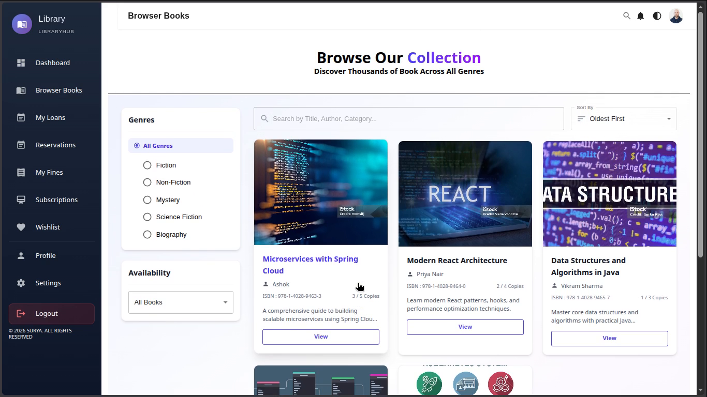
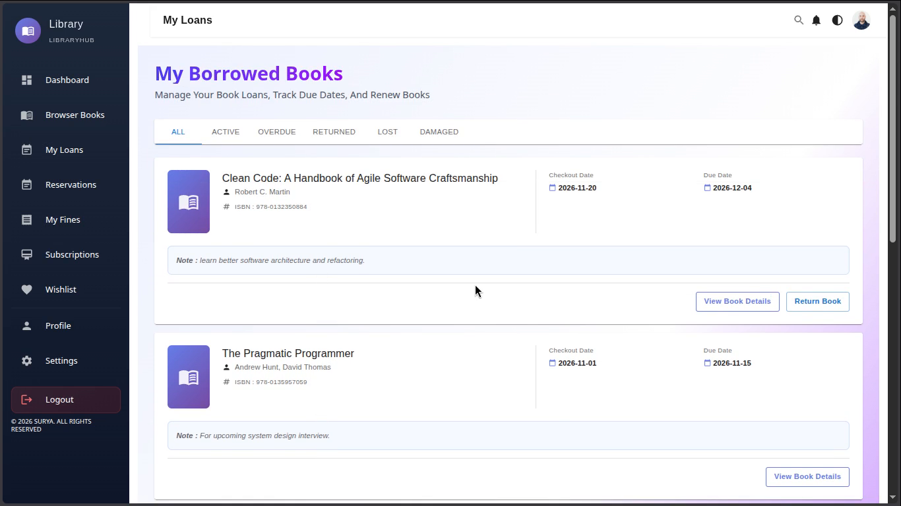
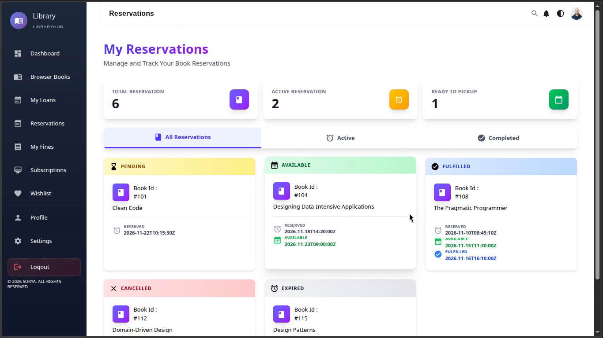
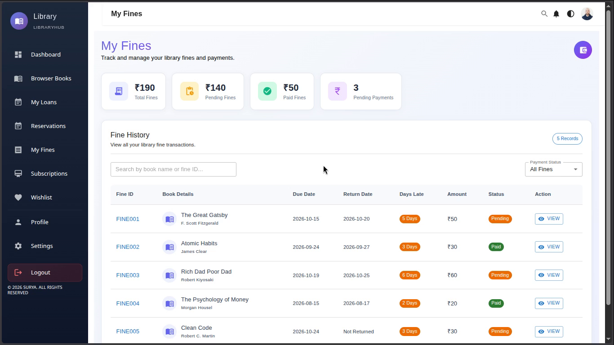
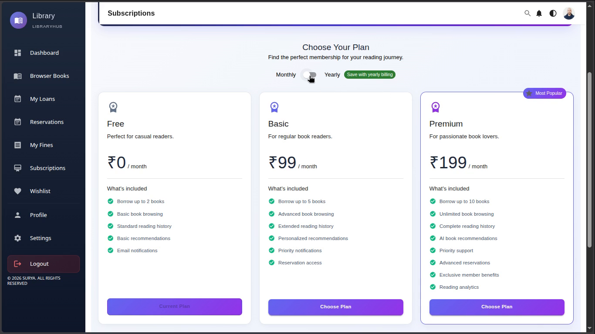
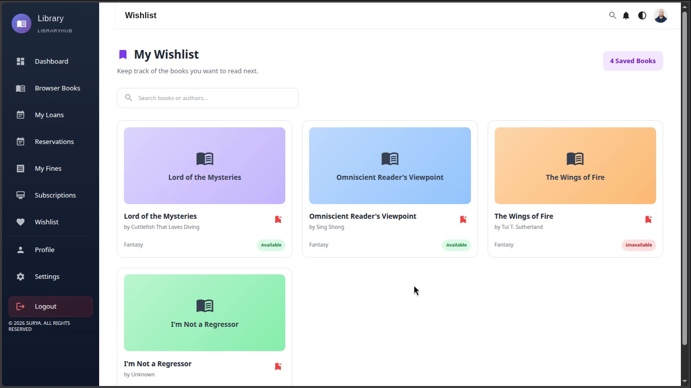
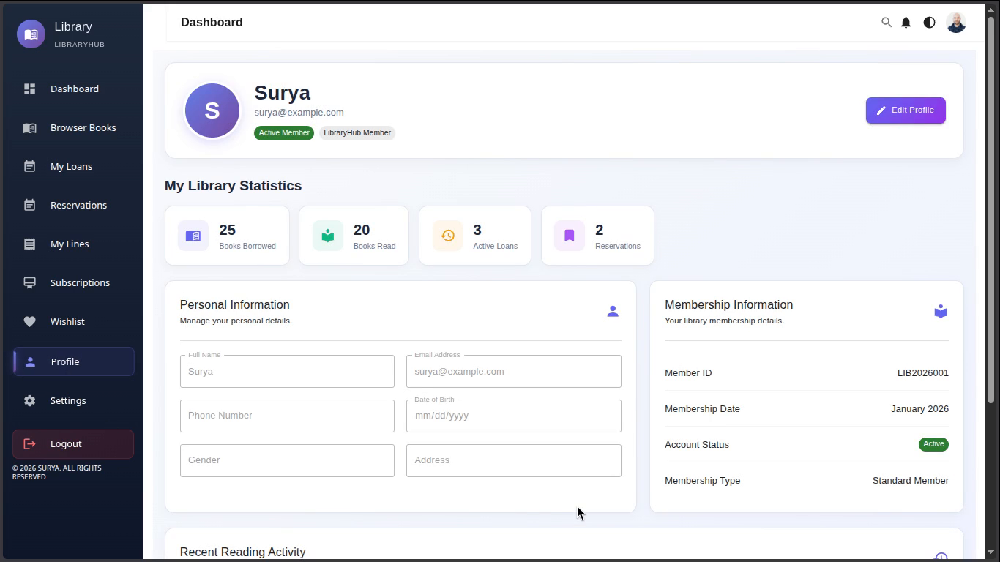

# 📚 LibraryHub — Library Management System (Frontend)

A responsive **React (Vite)** single-page application that gives library members and administrators a clean, role-based interface for browsing books, managing loans and reservations, paying fines, and running the library back office.

This is the frontend for the [Library Management System](https://github.com/suryav2006-git/library-management-system). It communicates with the **Spring Boot REST API** in the [`Backend/`](../../Backend) folder.


---

## 🌐 Live Demo

- **Frontend (Vercel):** [library-management-system-plum-kappa.vercel.app](https://library-management-system-plum-kappa.vercel.app)
- **Backend API (Render):** [library-management-system-1mh6.onrender.com](https://library-management-system-1mh6.onrender.com)

> **⚠️ Heads-up for testers:** The backend runs on Render's free tier and sleeps after 15 minutes of inactivity. The first request (login, loading books, etc.) can take **30–50 seconds** while the server wakes up. After that, everything runs at normal speed.

---

## 📸 Screenshots

A tour of the member portal, captured from the live deployment.

| Dashboard | Browse Books |
| :---: | :---: |
|  |  |

| My Loans | Reservations |
| :---: | :---: |
|  |  |

| Fines | Subscriptions |
| :---: | :---: |
|  |  |

| Wishlist | Profile |
| :---: | :---: |
|  |  |

---

## ✨ Features

### 👤 Member Portal
- **Secure sign-in:** Email/password and Google OAuth2 authentication, with password recovery via email
- **Dashboard:** Current loans, reservations on hold, books read, a day streak, and a yearly reading goal, with tabs for current loans, reservations, reading history, and recommendations
- **Book catalog:** Search by title, author, or category, filter by genre and availability, and sort results
- **My Loans:** Track every loan by status (active, overdue, returned, lost, damaged) with checkout and due dates
- **Reservations:** Follow each hold through its lifecycle: pending, available, fulfilled, cancelled, or expired
- **Fines:** See total, pending, and paid fines with a searchable history showing days late and payment status
- **Subscriptions:** Compare Free, Basic, and Premium plans with monthly or yearly billing, and review billing history
- **Online payments:** Pay for fines and subscriptions with Razorpay
- **Wishlist:** Save books for later and see their availability at a glance
- **Profile and settings:** Membership details, reading statistics, appearance (dark mode), notifications, language, and security options

### 🛠️ Admin Portal
- **Inventory management:** Add, edit, and remove books (individually or in bulk)
- **Genre management:** Create and organize the category hierarchy
- **Loan and fine oversight:** Monitor activity and waive penalties
- **Analytics:** View inventory and revenue insights at a glance

> Access is **role-based** (`ADMIN` / `USER`): the interface adapts to whoever is signed in.

---

## 🧰 Tech Stack

| Area | Description |
| --- | --- |
| **Framework** | React |
| **Build tool** | Vite |
| **Language** | JavaScript (ES6+) |
| **Styling** | CSS |
| **Package manager** | pnpm |
| **Authentication** | JWT (issued by the backend) and Google OAuth2 |
| **Payments** | Razorpay |
| **Hosting** | Vercel |

---

## 📂 Project Structure

```text
Frontend/library-frontend/
├── public/            # Static assets
├── screenshots/       # Images used in this README
├── src/
│   ├── assets/        # Images and icons
│   ├── components/    # Reusable UI components
│   ├── pages/         # Route-level pages
│   ├── App.jsx        # App shell and routing
│   └── main.jsx       # Entry point
├── index.html         # Vite HTML template
├── vercel.json        # SPA rewrite rules for client-side routing
├── vite.config.js     # Vite configuration
└── package.json       # Dependencies and scripts
```

---

## 🚀 Getting Started

### Prerequisites

- **Node.js 18+**
- **pnpm** (`npm install -g pnpm`)
- A running backend: either the [live API](https://library-management-system-1mh6.onrender.com) or a local instance (see the [root README](../../README.md))

### 1. Clone the repository

```bash
git clone https://github.com/suryav2006-git/library-management-system.git
cd library-management-system/Frontend/library-frontend
```

### 2. Install dependencies

```bash
pnpm install
```

### 3. Configure environment variables

Create a `.env` file in `Frontend/library-frontend/`:

<!-- Replace the variable name below with the one your code actually reads (import.meta.env.XXX) -->
```env
VITE_API_BASE_URL=http://localhost:8080
```

> **Note:** Vite only exposes variables prefixed with `VITE_` to the browser. Never put secrets (such as a Razorpay **secret** key) in frontend `.env` files.

### 4. Start the development server

```bash
pnpm dev
```

The app will be available at **http://localhost:5173**.

---

## 📜 Available Scripts

| Command | Description |
| --- | --- |
| `pnpm dev` | Starts the Vite development server with hot reload |
| `pnpm build` | Creates an optimized production build in `dist/` |
| `pnpm preview` | Serves the production build locally for testing |

---

## ☁️ Deployment (Vercel)

The frontend is deployed on **Vercel**.

1. Import the repository into Vercel.
2. Set the **Root Directory** to `Frontend/library-frontend`.
3. Select the **Vite** framework preset (build command: `pnpm build`, output directory: `dist`).
4. Add your API URL environment variable under **Project Settings → Environment Variables**.
5. Deploy.

`vercel.json` contains a rewrite rule so that deep links (e.g., `/books/123`) and page refreshes load the SPA instead of returning a `404` error.

> **CORS reminder:** The backend's `FRONTEND_URL` setting must match the deployed frontend URL, or API calls from the browser will be blocked.

---

## 🔗 Related

- [Root README](../../README.md) — Full-stack overview and backend setup
- [`Backend/`](../../Backend) — Spring Boot 4, Spring Security, JPA, MySQL / TiDB Cloud

---

## 🙏 Acknowledgments

Built alongside the Java Full Stack Library Management System tutorial series by [**CodeWithZosh**](https://www.youtube.com/@codewithzosh), then extended, containerized, and deployed across TiDB Cloud, Render, and Vercel.

---

## 📄 License

Licensed under the **MIT License**. See the [LICENSE](../../LICENSE) file for details.
