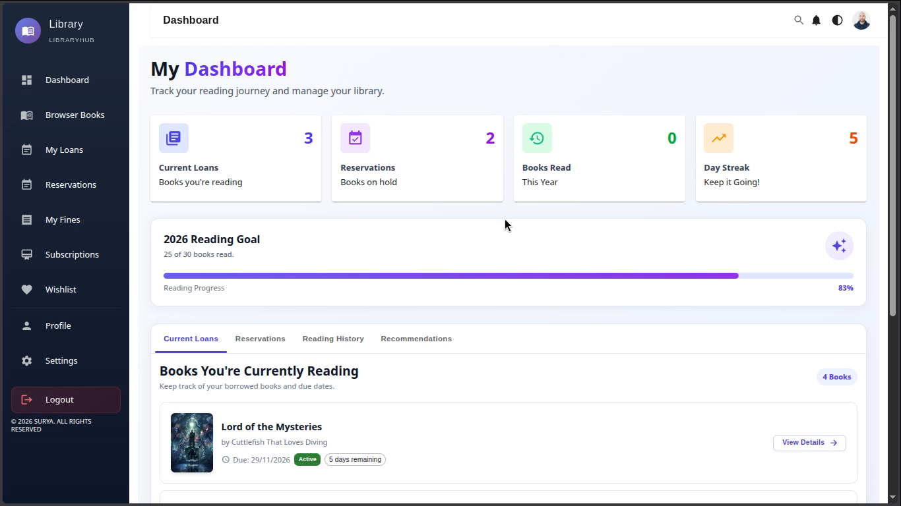
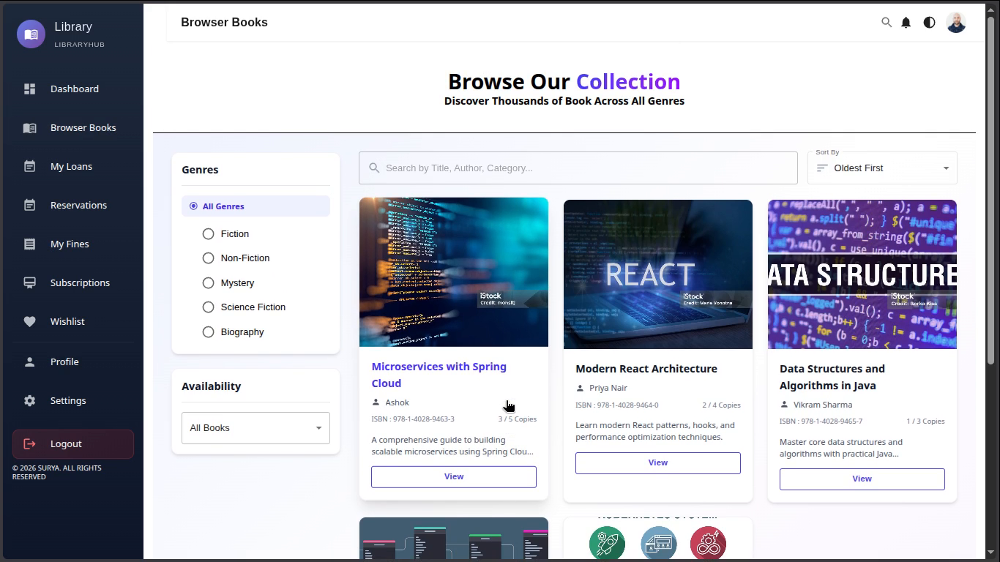
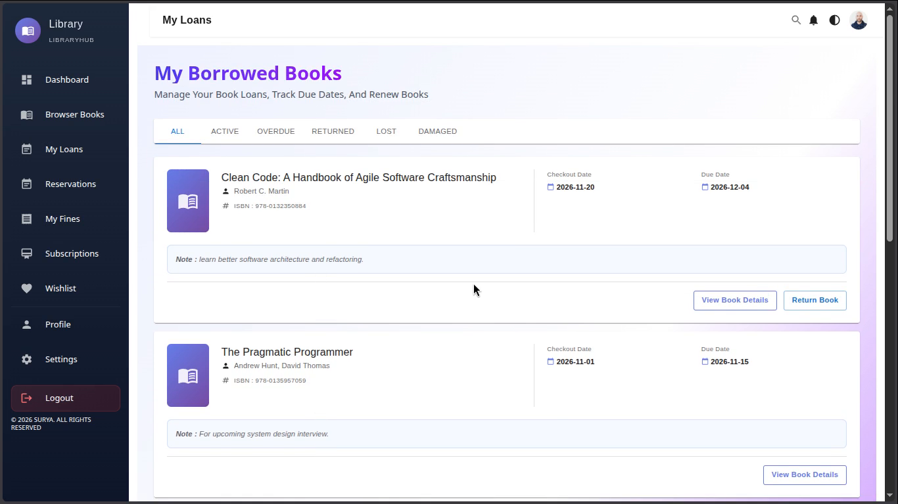
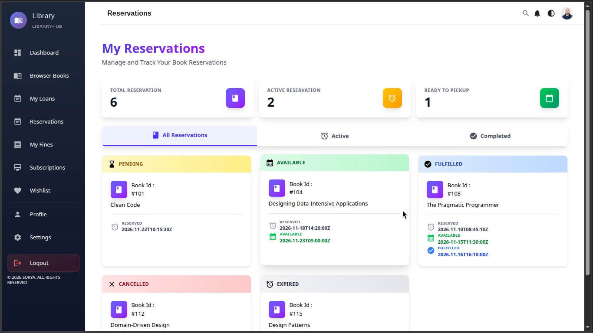
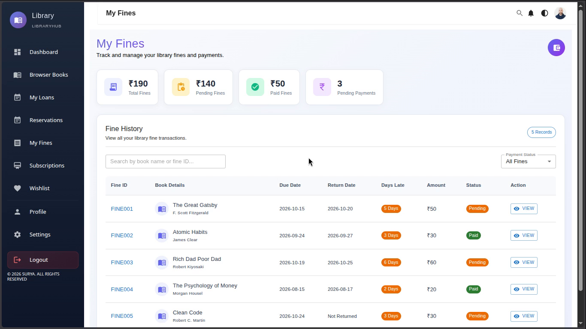
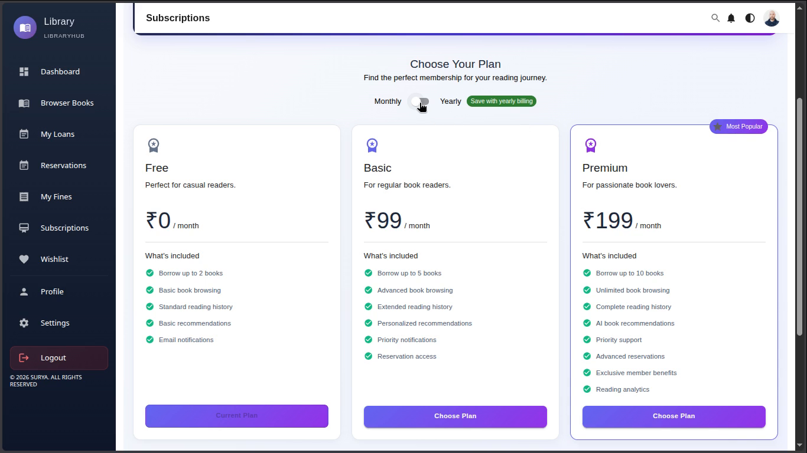
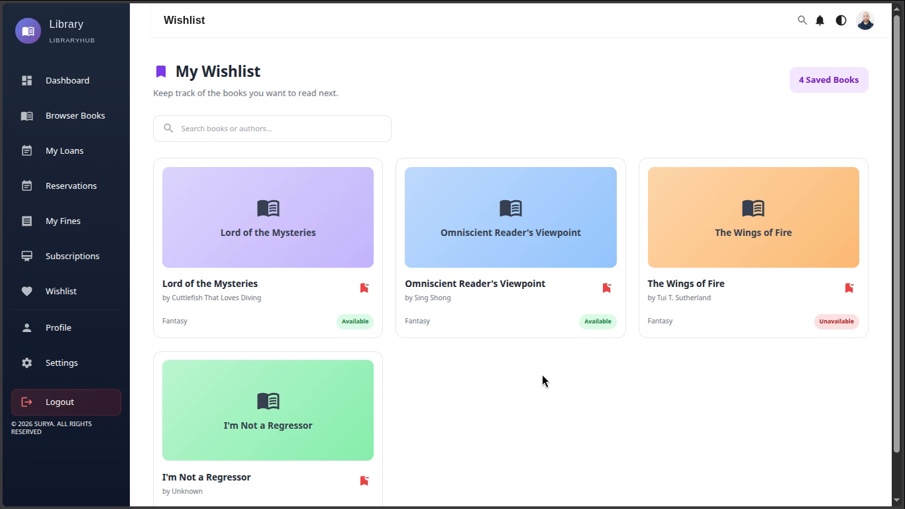
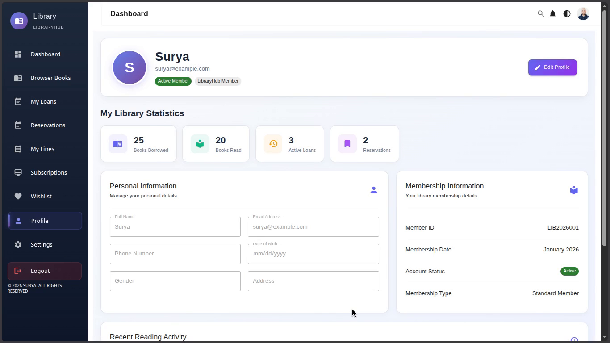

# 📚 Library Management System (Full-Stack)

A full-stack **Library Management System** built with **Java Spring Boot** and **React (Vite)**. Designed to streamline digital library operations—including role-based authentication, book catalog management, loan lifecycles, reservations, fine calculations, email notifications, and payment gateway integration.

---

## 🌐 Live Deployment

* **Live Frontend (Vercel):** [https://library-management-system-plum-kappa.vercel.app](https://library-management-system-plum-kappa.vercel.app)
* **Live Backend API (Render):** [https://library-management-system-1mh6.onrender.com](https://library-management-system-1mh6.onrender.com)
* **Cloud Database:** TiDB Cloud (MySQL-Compatible Serverless Cluster)
---
## 📸 Screenshots

A tour of the member portal, captured from the live deployment.

| Dashboard | Browse Books |
| :---: | :---: |
|  |  |

| My Loans | Reservations |
| :---: | :---: |
|  |  |

| Fines | Subscriptions |
| :---: | :---: |
|  |  |

| Wishlist | Profile |
| :---: | :---: |
|  |  |

---

> **⚠️ Note for Reviewers & Testers:** The backend API is hosted on Render's free tier, which spins down after 15 minutes of inactivity. Please allow **30–50 seconds** for the server to cold-start on the very first request.

---

## ✨ Key Features

* **Authentication & RBAC:** Stateless JWT and Google OAuth2 login, `ADMIN`/`USER` role permissions, and SMTP password recovery.
* **Inventory & Catalog Management:** Bulk/single book creation with unique ISBN validation, soft/hard deletion, real-time stock tracking, and multi-filter paginated search.
* **Hierarchical Genres:** Unlimited-depth parent-child category trees with active status toggles, custom ordering, and book counts.
* **Book Loan Lifecycle:** Automated checkout, return, and renewal workflows enforcing membership limits, renewal caps, and condition tracking (`RETURNED`, `OVERDUE`, `LOST`, `DAMAGED`).
* **FIFO Reservation Queue:** Automated waitlist for out-of-stock titles featuring queue tracking, pickup windows, and instant fulfillment on return.
* **Subscription & Membership Control:** Configurable membership tiers defining borrow limits and loan durations with immutable plan snapshots.
* **Fine & Penalty Engine:** Automated overdue, lost, and damaged book penalties supporting online settlement and admin waivers.
* **Razorpay Integration:** End-to-end payment link generation, verification, and event-driven activation for subscriptions and fines.
* **Verified Reviews & Wishlists:** Personal wishlists and book reviews restricted to members who have completed a loan for the title.
* **Role-Based Dashboards :** Dedicated member portal for loans, holds, reading goals, and fines, alongside an admin dashboard for inventory and revenue analytics.


---

## 🛠️ Tech Stack

| Layer | Technologies |
| :--- | :--- |
| **Backend** | Java 17, Spring Boot 4, Spring Security, Spring Data JPA (Hibernate), Spring Mail, Maven |
| **Frontend** | React, Vite, JavaScript (ES6+), CSS, pnpm |
| **Database** | MySQL / TiDB Cloud |
| **Security & Payments** | JWT (`jjwt`), Razorpay Java SDK |
| **DevOps & Hosting** | Docker (Multi-stage build), Render (Backend), Vercel (Frontend), GitHub |

---

## 📂 Project Structure

```text
library-management-system/
├── Backend/                        # Spring Boot REST API
│   ├── src/main/java/com/surya/    # Controllers, Services, Repositories, Models, Security
│   ├── src/main/resources/         # application.properties (environment-driven)
│   ├── Dockerfile                  # Multi-stage Maven + Temurin 17 Docker build
│   └── pom.xml                     # Maven dependencies
│
├── Frontend/
│   └── library-frontend/           # React + Vite SPA
│       ├── src/                    # Pages, components, assets
│       ├── vercel.json               # SPA client-side routing rewrite rules
│       └── package.json            # Frontend dependencies (pnpm)
│
├── LICENSE                         # MIT License
└── README.md
```

---

## 🚀 Running Locally

### Prerequisites
* **Java 17+** and **Maven**
* **Node.js 18+** and **pnpm**
* **MySQL 8.0+** (or a free TiDB Cloud cluster)

### 1. Clone the Repository
```bash
git clone https://github.com/suryav2006-git/library-management-system.git
cd library-management-system
```

### 2. Configure & Run the Backend
1. Navigate to the `Backend` folder:
   ```bash
   cd Backend
   ```
2. Create a `.env` file inside `Backend/` with your local configuration:
   ```env
   DB_URL=jdbc:mysql://localhost:3306/library_yt
   DB_USERNAME=root
   DB_PASSWORD=your_mysql_password
   MAIL_USERNAME=your_email@gmail.com
   MAIL_PASSWORD=your_gmail_app_password
   RAZORPAY_KEY_ID=your_razorpay_test_key
   RAZORPAY_KEY_SECRET=your_razorpay_test_secret
   FRONTEND_URL=http://localhost:5173
   ```
3. Start the Spring Boot server:
   ```bash
   ./mvnw spring-boot:run
   ```
   The API will start on `http://localhost:8080`.

### 3. Configure & Run the Frontend
1. Open a new terminal and navigate to `Frontend/library-frontend`:
   ```bash
   cd Frontend/library-frontend
   ```
2. Install dependencies and start the Vite development server:
   ```bash
   pnpm install
   pnpm dev
   ```
   The application will be available at `http://localhost:5173`.

---

## 🙏 Acknowledgments

* Built alongside the Java Full Stack Library Management System tutorial series by [**CodeWithZosh**](https://www.youtube.com/@codewithzosh), containerized with Docker, and deployed across TiDB Cloud, Render, and Vercel.
  
---

## 📄 License

This project is licensed under the **MIT License** — see the [LICENSE](LICENSE) file for details.
